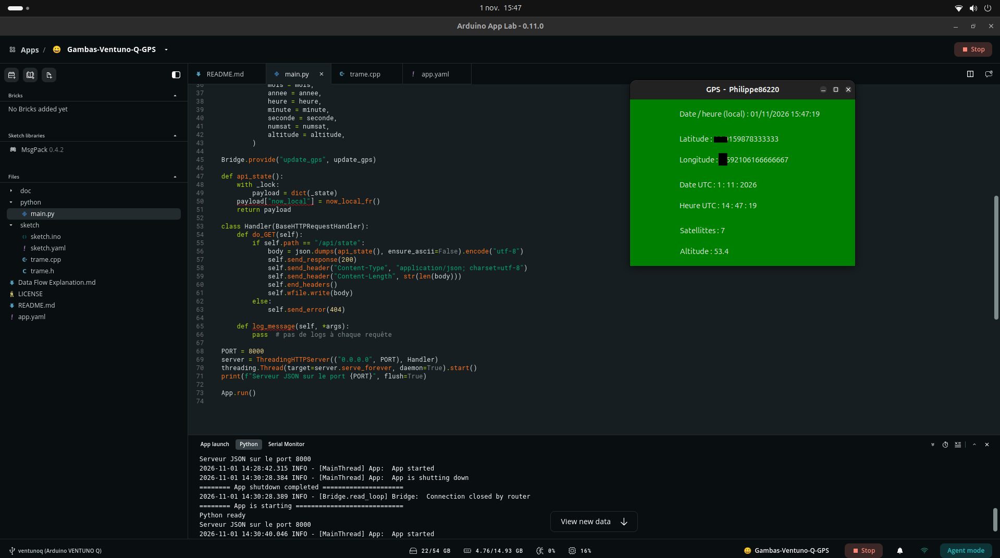

# Gambas-Ventuno-Q-GPS — Gambas3 Graphical Interface and JSON API

GPS application for **Arduino VENTUNO Q**: GPS data received by the MCU is transferred to the **Arduino App Lab** Python program, then displayed in a **native Gambas3 graphical interface** under Ubuntu.

This project follows the principle of the [UNO-Q-GPS](https://github.com/philippe86220/UNO-Q-GPS) project, which used an **HTML WebUI** interface on UNO Q. Here, the user interface is built with **Gambas3** on VENTUNO Q, without a WebUI Brick.



## Architecture

```text
GPS → MCU (Arduino sketch)
          │
          │ Arduino Bridge
          ▼
Arduino App Lab / main container
  main.py
  ├── Bridge.provide("update_gps", ...)
  ├── Python _state dictionary (protected by a Lock)
  └── HTTP server: 0.0.0.0:8000
                         │
                         │ GET /api/state → JSON
                         ▼
Ubuntu (VENTUNO Q host)
  Gambas3 application
  ├── HttpClient
  ├── JSON.Decode()
  └── display of coordinates, date, time, satellites, and altitude
```

The HTTP server does not provide direct access to Python variables: it **returns a JSON representation** of the selected values with each request. The data remains in memory in the Python process; no `.json` file on disk is required.

> **Important:** Direct access from Ubuntu to the container's private IP address was tested on this VENTUNO Q. It depends on the host's Docker network configuration and does not provide an address guaranteed to remain stable across all installations.

## Prerequisites

- Arduino VENTUNO Q with Ubuntu and Arduino App Lab.
- An App Lab application receiving GPS data from the MCU through `Bridge`.
- The Python HTTP server running in the `main` container on port **8000**.
- Gambas3 installed on Ubuntu, with the HTTP and JSON components used by the project.

## Installing Gambas3

On the VENTUNO Q's Ubuntu system:

```bash
sudo apt update
sudo apt install gambas3
```

If the components are not already installed by the main package, also install:

```bash
sudo apt install gambas3-gb-net-curl gambas3-gb-util-web
```

In the Gambas project properties, check that the **`gb.net.curl`** (HTTP client) and **`gb.util.web`** (JSON decoding) components are enabled. The exact names of available packages can be checked with `apt search gambas3`.

## Application name

The Arduino App Lab project is named **`Gambas-Ventuno-Q-GPS`**. Its associated Docker container is named **`gambas-ventuno-q-gps-main-1`**.

## Starting the App Lab application

Launch the GPS application in **Arduino App Lab** and wait for the `main` container to start.

Check its name:

```bash
docker ps --format 'table {{.Names}}\t{{.Ports}}'
```

In the tested configuration, the container is named:

```text
gambas-ventuno-q-gps-main-1
```

The `PORTS` column may be empty: **publishing a port to the host is not necessary for testing a direct connection to the container's IP address**, provided that this IP address is reachable from Ubuntu.

## Finding the container's IP address

```bash
docker inspect -f '{{range .NetworkSettings.Networks}}{{.IPAddress}}{{end}}' gambas-ventuno-q-gps-main-1
```

On the tested configuration, this command returned:

```text
172.25.0.2
```

This address is **an observed example**, not a permanent value. During testing, the container's address changed from `172.24.0.2` to `172.25.0.2`: automatic discovery avoids having to manually modify the Gambas code whenever it changes.

Test the API from Ubuntu (adjust the address as needed):

```bash
curl http://172.25.0.2:8000/api/state
```

A JSON response should contain the latest known GPS data, for example:

```json
{
  "lat": 43.91597,
  "long": 0.5820883333333333,
  "jour": 31,
  "mois": 10,
  "annee": 2026,
  "heure": 12,
  "minute": 43,
  "seconde": 49,
  "numsat": 6,
  "altitude": 46.9,
  "now_local": "31/10/2026 13:43:49"
}
```

## HTTP server in `main.py`

The Python program stores GPS data in an `_state` dictionary. The `update_gps(...)` function, exposed through `Bridge.provide(...)`, updates this dictionary whenever the MCU sends data. A `threading.Lock()` protects concurrent access.

The `ThreadingHTTPServer` listens on `0.0.0.0:8000` inside the container and responds to:

```text
GET /api/state
```

It serializes the current state using `json.dumps(...)`, setting the content type to `application/json`.

The code also provides French local time using:

```python
import datetime
from zoneinfo import ZoneInfo

def now_local_fr():
    return datetime.datetime.now(ZoneInfo('Europe/Paris')).strftime('%d/%m/%Y %H:%M:%S')
```

The `api_state()` function calls `now_local_fr()` and adds `payload["now_local"]` to the response. The full code is available in the project's source files.

## Gambas3 interface

The Gambas form uses a `Timer` to periodically query the API, read the response, and display the values.

Representative excerpt from the tested code:

```gambas
Public Sub Timer1_Timer()

  Dim client As HttpClient
  Dim Reponse As String
  Dim Data As Collection

  client = New HttpClient
  client.URL = "http://172.25.0.2:8000/api/state"
  client.Async = False
  client.Timeout = 40
  client.Get()

If client.Status < 0 Then
    Print "Erreur"
    Return
  Else
   ' Succès - données lues.
    If Lof(client) Then Reponse = Read #client, Lof(client)
    Print Reponse
  End If

  Data = JSON.Decode(Reponse)

  Latitude.Text = "Latitude : " & Data["lat"]
  Longitude.Text = "Longitude : " & Data["long"]
  Date.Text = "Date UTC : " & Data["jour"] & " : " & Data["mois"] & " : " & Data["annee"]
  Heure.Text = "Heure UTC : " & Data["heure"] & " : " & Data["minute"] & " : " & Data["seconde"]
  Satellites.Text = "Satellittes : " & Data["numsat"]
  Altitude.Text = "Altitude : " & Data["altitude"]
  Date_heure_FR.Text = "Date / heure (local) : " & Data["now_local"]

End
```

This excerpt illustrates the first version with a fixed IP address. The next section shows how to replace it with an address automatically discovered using `Shell`. The date and time fields coming from the GPS are labeled UTC here.

### Automatically discovering the IP address from Gambas3

Gambas3 can execute a Linux command with `Shell` and capture its output in a variable using `To`. This makes it possible to find the IP address assigned by Docker **without hard-coding it**.

In the Gambas form, declare a variable accessible to the other procedures:

```gambas
Private AdresseServeur As String

Public Sub Form_Open()

  Dim IP As String

  Shell "docker inspect -f '{{range .NetworkSettings.Networks}}{{.IPAddress}}{{end}}' gambas-ventuno-q-gps-main-1" To IP
  IP = Trim(IP)

  If IP = "" Then
    Message.Error("Conteneur introuvable ou sans adresse IP.   Démarrez d'abord l'application App Lab.")
    Return
  Endif

  AdresseServeur = "http://" & IP & ":8000/api/state"
  Print "Serveur GPS : "; AdresseServeur

End
```

In `Timer1_Timer()`, replace the fixed address:

```gambas
client.URL = "http://172.25.0.2:8000/api/state"
```

with:

```gambas
If AdresseServeur = "" Then Return
client.URL = AdresseServeur
```

**Requirements and limitations:** the App Lab application must be started before Gambas3; the Ubuntu user must be able to run `docker inspect` without a permission error. If the container is recreated **while** Gambas is running, the address must be discovered again. For a more robust program, also handle command errors and containers with multiple network interfaces.

This technique can be reused for other Linux commands: `Shell "uname -r" To Resultat`, for example, retrieves the kernel version into a Gambas variable.

### Possible improvements

- Check the HTTP response status code, the presence of a JSON response body, and decoding errors.
- Avoid a synchronous request in the `Timer` if response delays could freeze the graphical interface; use an asynchronous request instead.
- Provide a clear message when the GPS has not yet obtained a position (`null`).

## Why this approach?

This solution makes it possible to **separate processing from the graphical interface**: App Lab manages the MCU, the Bridge, and the Python server; Gambas3 handles the native display under Ubuntu.

It requires **neither a WebUI Brick nor a custom Brick solely to expose JSON**. A Brick may nevertheless be useful if the project requires specific dependencies or services, or to organize reusable features.

The same architecture can be reused for other data: sensors, analog measurements, input/output states, dashboards, etc.

## Original project

- [UNO-Q-GPS — GPS project for Arduino UNO Q with an HTML WebUI interface](https://github.com/philippe86220/UNO-Q-GPS)

### Acknowledgments

This project was developed with the assistance of **ChatGPT (OpenAI)**, particularly in exploring the communication architecture between Arduino App Lab and Gambas3, implementing the Python HTTP server, and analyzing and documenting the code.

The various solutions were experimented with, tested, and validated on an Arduino VENTUNO Q.

---

*Experimental project developed and tested on Arduino VENTUNO Q. Network details and available components may change depending on the versions of Arduino App Lab and Ubuntu.*
