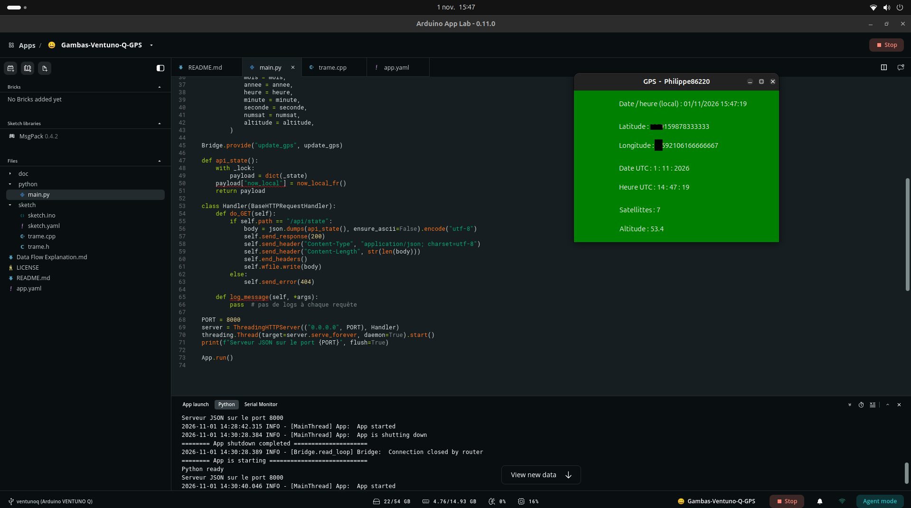

# Gambas-Ventuno-Q-GPS — Interface graphique Gambas3 et API JSON

Application GPS pour **Arduino VENTUNO Q** : les données GPS reçues par le MCU sont transférées au programme Python d'**Arduino App Lab**, puis affichées dans une **interface graphique native Gambas3** sous Ubuntu.

Ce projet reprend le principe du projet [UNO-Q-GPS](https://github.com/philippe86220/UNO-Q-GPS), qui utilisait une interface **WebUI HTML** sur UNO Q. Ici, l'interface utilisateur est réalisée avec **Gambas3** sur VENTUNO Q, sans Brick WebUI.



## Architecture

```text
GPS → MCU (sketch Arduino)
          │
          │ Arduino Bridge
          ▼
Arduino App Lab / conteneur main
  main.py
  ├── Bridge.provide("update_gps", ...)
  ├── dictionnaire Python _state (protégé par un Lock)
  └── serveur HTTP : 0.0.0.0:8000
                         │
                         │ Port Docker publié : 8000
                         │ GET http://localhost:8000/api/state → JSON
                         ▼
Ubuntu (hôte VENTUNO Q)
  Application Gambas3
  ├── HttpClient
  ├── JSON.Decode()
  └── affichage des coordonnées, date, heure, satellites et altitude
```

Le serveur HTTP ne donne pas directement accès aux variables Python : il **renvoie une représentation JSON** des valeurs sélectionnées lors de chaque requête. Les données restent en mémoire dans le processus Python ; aucun fichier `.json` sur disque n'est nécessaire.

> **Important :** le port **8000** est déclaré dans `app.yaml`. Arduino App CLI utilise cette déclaration pour générer la correspondance des ports dans Docker Compose. Gambas3 peut ainsi se connecter à `http://localhost:8000/api/state` sans rechercher l'adresse IP du conteneur.

## Prérequis

- Arduino VENTUNO Q avec Ubuntu et Arduino App Lab.
- Une application App Lab recevant les données GPS du MCU par `Bridge`.
- Le serveur HTTP Python lancé dans le conteneur `main` sur le port **8000**.
- Gambas3 installé sur Ubuntu, avec les composants HTTP et JSON utilisés par le projet.

## Installer Gambas3

Sur l'Ubuntu de la VENTUNO Q :

```bash
sudo apt update
sudo apt install gambas3
```

Si les composants ne sont pas déjà installés par le paquet principal, installer également :

```bash
sudo apt install gambas3-gb-net-curl gambas3-gb-util-web
```

Dans les propriétés du projet Gambas, vérifier que les composants **`gb.net.curl`** (client HTTP) et **`gb.util.web`** (décodage JSON) sont activés. Les noms exacts des paquets disponibles peuvent être vérifiés avec `apt search gambas3`.

## Publier le port du serveur HTTP

Dans le fichier `app.yaml` du projet App Lab, déclarer le port utilisé par le serveur HTTP Python :

```yaml
ports:
  - 8000
```

Si le fichier contient `ports: []`, remplacer cette ligne par la configuration ci-dessus. Arduino App Lab considère `app.yaml` comme un fichier en lecture seule dans son éditeur, mais il est possible de le modifier depuis un éditeur externe, par exemple `nano` dans un terminal. Enregistrer la modification, puis relancer l'application App Lab pour que la configuration Docker Compose générée et le conteneur en cours d'exécution prennent en compte la publication du port.

Arduino App CLI génère alors un fichier `.cache/app-compose.yaml` contenant une configuration équivalente à :

```yaml
ports:
  - mode: ingress
    target: 8000
    published: "8000"
    protocol: tcp
```

**Modifier `app.yaml`, et non le fichier généré `.cache/app-compose.yaml`.** Ce dernier peut être recréé automatiquement par App CLI.

Le port 8000 doit être disponible sur l'hôte Ubuntu. Selon la configuration réseau et le pare-feu, un port publié par Docker peut être accessible depuis d'autres interfaces réseau que `localhost` : cette publication ne garantit donc pas, à elle seule, un accès exclusivement local.

## Démarrer et tester l'application App Lab

Lancer l'application GPS dans **Arduino App Lab** et attendre le démarrage du conteneur `main`. Depuis un terminal Ubuntu sur la VENTUNO Q, tester :

```bash
curl http://localhost:8000/api/state
```

Une réponse JSON doit contenir les dernières données GPS connues, par exemple :

```json
{
  "lat": 46.915963166666664,
  "long": 0.5920348333333333,
  "jour": 4,
  "mois": 11,
  "annee": 2026,
  "heure": 7,
  "minute": 44,
  "seconde": 3,
  "numsat": 7,
  "altitude": 53.3,
  "now_local": "04/11/2026 08:44:03"
}
```

Il n'est **plus nécessaire d'exécuter `docker inspect` ni de rechercher l'adresse IP du conteneur**. Le port publié sur l'hôte reste identique même si Docker attribue une autre adresse IP privée au conteneur.

## Pourquoi certains noms de conteneurs comportent-ils deux `main` ?

Le nom d'un conteneur Docker Compose est construit à partir du **nom du projet Compose**, du **nom du service** et d'un numéro d'instance.

- Une application développée localement, avec l'identifiant `gambas-ventuno-q-gps` et le service `main`, peut produire le nom `gambas-ventuno-q-gps-main-1`.
- La fonction **Download ZIP** de GitHub, utilisée sur la branche par défaut `main`, produit une archive telle que `Gambas-Ventuno-Q-GPS-main.zip`, contenant un dossier racine portant le même suffixe `-main`. L'importation de ce dossier dans App Lab entraîne l'identifiant `gambas-ventuno-q-gps-main`. Avec le service `main`, le conteneur peut alors être nommé `gambas-ventuno-q-gps-main-main-1`.

Dans ce second exemple, le premier `main` provient du nom de la branche Git repris dans le nom du dossier importé ; le second correspond au service Docker Compose. **Gambas3 n'a plus besoin de connaître ces noms** puisque le port du serveur est publié.

## Serveur HTTP dans `main.py`

Le programme Python conserve les données GPS dans un dictionnaire `_state`. La fonction `update_gps(...)`, exposée via `Bridge.provide(...)`, actualise ce dictionnaire à chaque transmission du MCU. Un verrou `threading.Lock()` protège les accès concurrents.

Le serveur `ThreadingHTTPServer` écoute sur `0.0.0.0:8000` dans le conteneur et répond à :

```text
GET /api/state
```

Il sérialise l'état courant avec `json.dumps(...)`, en définissant le type de contenu `application/json`.

Le code fournit également l'heure locale française grâce à :

```python
import datetime
from zoneinfo import ZoneInfo

def now_local_fr():
    return datetime.datetime.now(ZoneInfo('Europe/Paris')).strftime('%d/%m/%Y %H:%M:%S')
```

La fonction `api_state()` appelle `now_local_fr()` et ajoute `payload["now_local"]` à la réponse. Le code complet figure dans les fichiers sources du projet.

## Interface Gambas3

Le formulaire Gambas utilise `Timer1` pour interroger périodiquement l'API HTTP, décoder la réponse JSON et afficher les valeurs GPS. Puisque le port HTTP est publié sur l'hôte Ubuntu, l'adresse peut être fixe :

```gambas
client.URL = "http://localhost:8000/api/state"
```

Il n'est plus nécessaire de rechercher le conteneur Docker ni son adresse IP. Voici les procédures correspondantes du programme Gambas3 testé :

```gambas
' Gambas class file

Public Sub Timer1_Timer()

  Dim client As HttpClient
  Dim Reponse As String
  Dim Data As Collection

  client = New HttpClient
  client.URL = "http://localhost:8000/api/state"
  client.Async = False
  client.Timeout = 40
  client.Get()

  If client.Status < 0 Then
    Print "Erreur"
    Quit
  Else
    ' Succès : lecture du corps de la réponse.
    If Lof(client) Then Reponse = Read #client, Lof(client)
    Print Reponse
  Endif

  Data = JSON.Decode(Reponse)

  Latitude.Text = "Latitude : " & Data["lat"]
  Longitude.Text = "Longitude : " & Data["long"]
  Date.Text = "Date UTC : " & Data["jour"] & " : " & Data["mois"] & " : " & Data["annee"]
  Heure.Text = "Heure UTC : " & Data["heure"] & " : " & Data["minute"] & " : " & Data["seconde"]
  Satellites.Text = "Satellites : " & Data["numsat"]
  Altitude.Text = "Altitude : " & Data["altitude"]
  Date_heure_FR.Text = "Date / heure (local) : " & Data["now_local"]

End

Public Sub Form_Open()
  Timer1.Start
End
```

**Démarrer l'application App Lab avant Gambas3.** Le serveur Python et le programme Gambas3 doivent fonctionner sur la VENTUNO Q. L'intervalle de `Timer1` se règle dans l'éditeur de formulaire ; le Timer est démarré dans `Form_Open()`.

### Conditions et limites

- L'exemple utilise des requêtes HTTP synchrones (`client.Async = False`), qui peuvent bloquer brièvement l'interface si le serveur tarde à répondre.
- Le programme détecte un état négatif du client, mais ne vérifie pas séparément le code de réponse HTTP et ne gère pas les réponses JSON vides ou mal formées.
- En cas d'erreur de connexion, le programme quitte ; la reconnexion automatique n'est pas implémentée.
- Si App Lab recrée le conteneur, l'adresse publiée reste `localhost:8000` dès que le service est de nouveau opérationnel. Gambas3 ne dépend plus du nom du conteneur ni de son adresse IP privée.
- Si le GPS n'a pas encore obtenu de position, certaines valeurs peuvent être indisponibles ou `null` ; l'affichage pourrait être amélioré pour traiter explicitement ce cas.

## Pourquoi cette approche ?

Cette solution permet de **séparer les traitements et l'interface graphique** : App Lab gère le MCU, le Bridge et le serveur Python ; Gambas3 s'occupe de l'affichage natif sous Ubuntu.

Elle n'impose **aucune Brick WebUI ni Brick personnalisée pour la seule exposition du JSON**. Une Brick peut toutefois rester utile si le projet requiert des dépendances ou services spécifiques, ou pour organiser des fonctionnalités réutilisables.

La même architecture peut être réemployée pour d'autres données : capteurs, mesures analogiques, états d'entrées/sorties, tableaux de bord, etc.

## Projet d'origine

- [UNO-Q-GPS — projet GPS pour Arduino UNO Q avec interface WebUI HTML](https://github.com/philippe86220/UNO-Q-GPS)

### Remerciements

Ce projet a été développé avec l'aide de **ChatGPT (OpenAI)**, notamment pour explorer l'architecture de communication entre Arduino App Lab et Gambas3, mettre en place le serveur HTTP Python, analyser le code et rédiger la documentation.

Les différentes solutions ont été expérimentées, testées et validées sur une Arduino VENTUNO Q. Merci également à **ptillisch**, sur le forum Arduino, pour ses explications sur la déclaration du port dans `app.yaml` et l'origine des noms des conteneurs Docker Compose.

---

*Projet expérimental développé et testé sur Arduino VENTUNO Q. Les détails réseau et les composants disponibles peuvent évoluer selon les versions d'Arduino App Lab et d'Ubuntu.*
